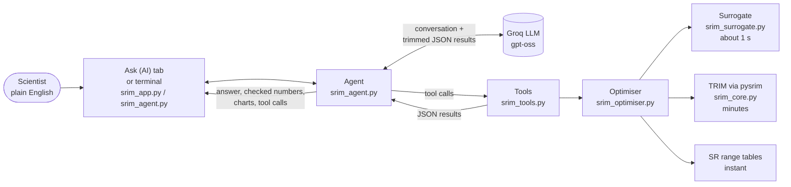
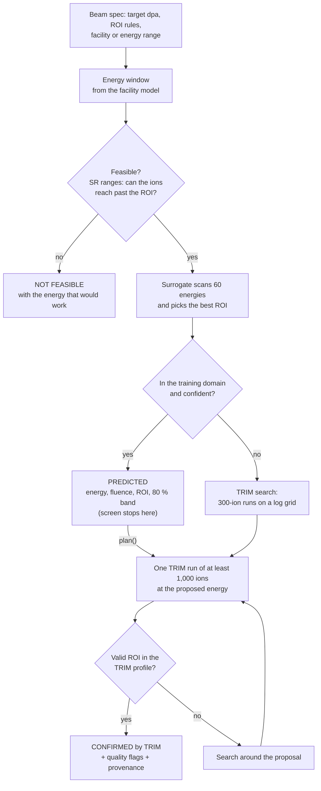
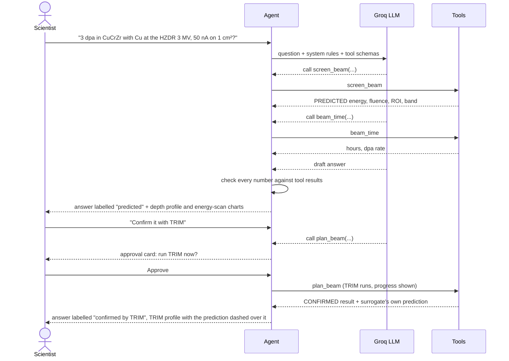
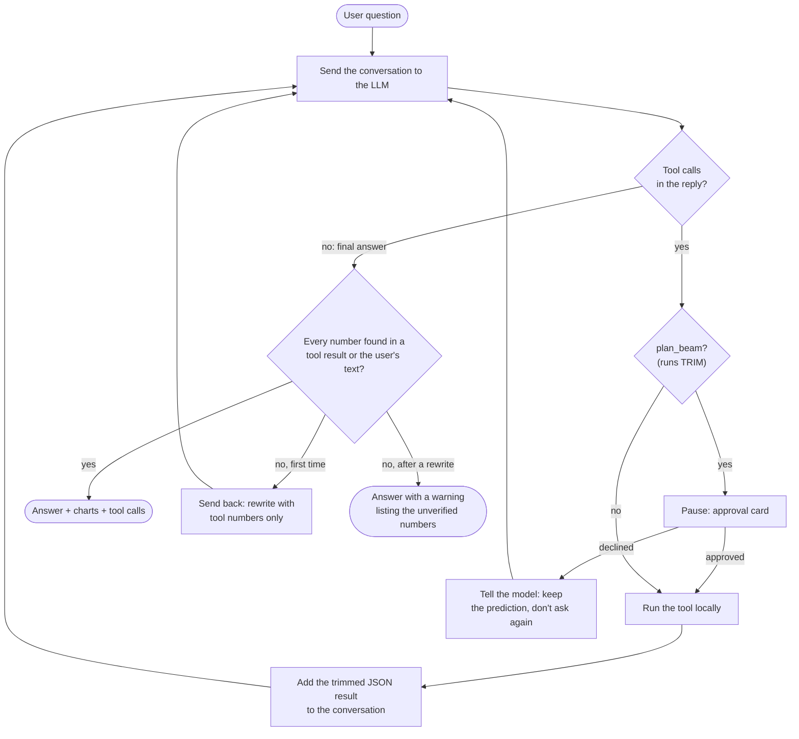

# srim_opt: one-click ion-irradiation planning

Planning a heavy-ion irradiation means finding the **beam energy and fluence** that put a target dose
(dpa) into a region of interest (ROI) below a sample's surface. Done by hand, that is a series of SRIM/TRIM
simulations of a few minutes each, plus a spreadsheet.

srim_opt does it in one step:

- **A surrogate model** trained on 1,357 TRIM runs predicts the answer in about a second.
- **One real TRIM run** confirms the prediction.
- **An AI assistant** takes the request in plain English and answers with numbers from these tools only.

> **Ask (AI):** *"I need 3 dpa in CuCrZr with Cu ions at the HZDR 3 MV Tandetron. What energy and fluence,
> and how long at 50 nA on 1 cm²?"*
>
> **Predicted:** 18 MeV Cu⁵⁺, 1.283 × 10¹⁶ ions/cm² (80 % band 1.219–1.347 × 10¹⁶), ROI 469.5–860.8 nm,
> about 57 h of beam. Ask it to confirm, and it runs TRIM.

## Results

| | |
|---|---|
| **TRIM runs to an answer** | 5 instead of 33 over five benchmark cases (19 min of TRIM instead of 109) |
| **Surrogate accuracy** | 2.8 % median fluence error on ion–target pairs it never saw |
| **Dataset** | 1,357 TRIM runs: 15 heavy ions (C to Au) into 13 nuclear materials, 0.5–50 MeV |
| **Facilities** | 11 accelerators, giving the energy window, charge state and terminal voltage |

Four of the five benchmark cases matched the best energy found by a full grid. In the fifth, Ni → Ni for the
lowest fluence, the answer needs 4.8 % more fluence than the best one. Figures are in
[srim_outputs/figures/](srim_outputs/figures/), and the benchmark is in
[srim_outputs/benchmark/](srim_outputs/benchmark/).

## Quick start (Windows)

You need Python 3.13. Without SRIM you get the AI assistant and every prediction. With SRIM installed you
also get TRIM-confirmed results.

```powershell
git clone https://github.com/rizzyrr/srim_opt.git
cd srim_opt
py -3.13 -m venv .venv313
.venv313\Scripts\pip install -r requirements.txt
.venv313\Scripts\python -m pytest tests          # 56 tests, no SRIM or API key needed
```

Then [add a Groq API key](#add-your-groq-api-key) and start the app:

```powershell
run_srim_gui.bat                                  # or: .venv313\Scripts\python -m streamlit run srim_app.py
```

The app opens in your browser. Open the **Ask (AI)** tab.

## Add your Groq API key

The AI assistant runs on [Groq](https://console.groq.com). Everything else works without a key.

1. **Get a key.** Sign in at [console.groq.com](https://console.groq.com), open **API Keys** and create one.
   It starts with `gsk_`. Copy it now, because Groq shows it only once.
2. **Save it as a Windows user environment variable:**
   1. Press the Windows key and type **environment variables**.
   2. Open **Edit environment variables for your account**.
   3. Under **User variables**, click **New**. Enter `GROQ_API_KEY` as the name and paste your key as the
      value.
   4. Click **OK**, then **OK** again.
3. **Check it** in a PowerShell terminal. This prints the key's length, not the key:
   ```powershell
   $v = [Environment]::GetEnvironmentVariable("GROQ_API_KEY","User"); "length $($v.Length), starts with gsk_: $($v.StartsWith('gsk_'))"
   ```
   You should see a length of about 56 and `True`.

The app reads the saved key even in terminals that were open before you added it.

**Keep the key out of the project.** Don't put it in a file in this folder, including a `.env` file, a
notebook or a screenshot. The folder gets zipped, uploaded and screen-shared. `.env` files are in
`.gitignore` as a backstop. If a key leaks, revoke it in the Groq console and make a new one.

<details>
<summary>macOS / Linux, or a key for one terminal session only</summary>

```bash
export GROQ_API_KEY=gsk_...        # this terminal only; add it to ~/.zshrc or ~/.bashrc to keep it
```

On Windows, for one PowerShell session only:

```powershell
$env:GROQ_API_KEY = Read-Host "Groq key"
```

To remove a saved Windows key: `[Environment]::SetEnvironmentVariable("GROQ_API_KEY", $null, "User")`.
</details>

**Choosing a model:** the default is `openai/gpt-oss-20b`, which is fast and cheap. To use another Groq model,
set `GROQ_MODEL` the same way, for example `openai/gpt-oss-120b`. Larger models are more reliable at filling
in a beam specification and at multi-step tool use.

## Install SRIM (optional: TRIM-confirmed results)

1. Download **SRIM-2013** from [srim.org](http://www.srim.org). It is free for non-commercial use.
2. Extract it to a folder, for example `C:\Users\<you>\Documents\SRIM`.
3. Run the setup in its `SRIM-Setup` folder as administrator. On Windows 10 and 11, TRIM fails to start
   with a missing `.ocx` error without this step.
4. Type the folder into **SRIM folder** at the top of the app's sidebar. Once TRIM.exe is found there, the
   folder is remembered on this computer, in `srim_outputs/settings.json`, which is not in git. A user
   environment variable `SRIM_DIR` overrides it. The terminal tools use the same setting.

The SR range tables for the dataset's ion–target pairs are already in the repo, so predictions for those
pairs work without SRIM.

## Using it

**Ask (AI) tab.** Describe the experiment: target dpa, material, ion, and a facility or energy range. The
assistant:

1. Asks for anything essential you left out. It does not guess.
2. Predicts the energy, fluence and ROI with the surrogate, in about a second. It labels these numbers
   **predicted**.
3. Runs TRIM when you ask it to confirm, usually once and for 2–15 minutes. It labels these numbers
   **confirmed by TRIM**.
4. Tells you which defaults it assumed (ROI start and width, ±10 % flatness, implant margin), passes on
   warnings, and explains failures with the value to change.

Under each prediction or confirmed result, two charts appear:
- **Depth profile:** the dpa and implanted-ion profiles with the ROI and target marked. For a confirmed
  result, TRIM's profile is drawn with the surrogate's prediction dashed over it.
- **Energy scan:** the objective against beam energy.

**Tool calls** shows every tool call behind the answer, with the arguments and the full result.

**Terminal:** `.venv313\Scripts\python srim_agent.py` chats with the same assistant, and
`srim_agent.py "question"` asks one question. There are no charts in the terminal.

**Without the AI:** the app has four main tabs.
- **Optimise → One-click** gives the same answer from a form, using the ion and material set in the sidebar.
- **Optimise → Manual grid** runs TRIM on an energy grid you choose.
- **More tools** holds single TRIM runs, energy sweeps, fluence and ROI, run comparison and convergence
  checks.

### How the assistant keeps to the physics

- **Every number comes from a tool.** After each answer, every number is checked against the tool results
  and what you typed. An answer that quotes a number no tool produced is sent back to be rewritten. If it
  still has one, the app shows a warning.
- **Predictions and confirmed results are labelled differently.** The tools label every result as
  `PREDICTED`, `CONFIRMED by TRIM` or `NOT FEASIBLE`, and the model is told never to present a prediction
  as confirmed.
- **The language model only reads and writes text.** All physics runs in this repo's Python code and on
  your machine. Groq receives the conversation and short JSON summaries of tool results, not your files.

**Limits:** the check catches invented numbers. It cannot catch a wrong conclusion drawn from correct numbers,
or something the model left out. Treat answers as a planning aid, and check the confirmed numbers and the
**Tool calls** panel before you book beam time.

## How it works



The language model never computes anything. It reads the question, chooses tools and their arguments, and
writes the answer from the tools' results. All physics runs locally in this repo's Python code.

- **dpa scales linearly with fluence.** For a given energy, the fluence that gives the target dpa can be
  calculated exactly. Only the energy has to be searched, and that is the expensive part.
- **The surrogate is a Gaussian process.** It predicts TRIM's damage-energy and implanted-ion profiles
  from the ion, the target and the energy. What physics already fixes (range scaling, the NRT formula, the
  displacement energy) is taken out before training. It proposes an energy, and one TRIM run of at least
  1,000 ions confirms it.
- **Damage is NRT dpa** from SRIM Quick Kinchin-Pease (Stoller et al. 2013), with ASTM E521
  displacement energies.

The Python API (`screen()`, `plan()`, `beam_time()` and the facility functions) is listed at the top of
[srim_optimiser.py](srim_optimiser.py).

### How a beam is chosen

`screen()` and `plan()` in `srim_optimiser.py`:



Fluence is never searched: for a chosen energy and ROI it is calculated exactly, because dpa is linear in
fluence.

## Inside the AI assistant

The assistant (`srim_agent.py`) is a plain tool-calling loop on Groq's OpenAI-compatible API, with no agent
framework. `srim_tools.py` wraps the optimiser as five JSON tools, so the language model can be swapped
without touching the physics.

| Tool | What it does | Time |
|---|---|---|
| `list_options` | Known materials, facilities and objectives | instant |
| `energy_window` | Energies a facility can deliver for an ion (one facility, or all) | instant |
| `screen_beam` | Predicted best energy, fluence and ROI from the surrogate | about 1 s |
| `plan_beam` | The same, confirmed by a TRIM run. **Needs your approval** | 2–15 min |
| `beam_time` | Irradiation time and dpa rate at a beam current | instant |

### A typical conversation



### The agent's loop

What `Agent.ask()` and `Agent.resume()` do with each question:



At most 10 model calls are made per question, tool rounds included. Groq rate limits are retried twice.

### Guardrails

- **The number check.** `check_numbers()` extracts every number in the answer, including forms like
  1.28e16, 1.28 × 10¹⁶ and 1,000. Each must match a number in a tool result, the user's messages or the
  system prompt, to the precision quoted. Small integers such as list numbering are exempt, and a
  percentage may quote a fraction (0.1 as 10 %). Tool results are rounded to 4 significant figures, so the
  model can copy them exactly instead of re-rounding.
- **Labels the model can't blur.** Every tool result carries a `status`, and the system prompt forbids
  presenting a prediction as confirmed:

  | Status | Source |
  |---|---|
  | `PREDICTED` | surrogate model, not verified |
  | `CONFIRMED by TRIM simulation` | a real TRIM run |
  | `NOT FEASIBLE` | SR range tables: the ions can't reach past the ROI in this energy window |
  | `ENERGY WINDOW ONLY` | SR ranges; the surrogate declined (outside its domain or unsure) |

- **It asks rather than guesses.** Without a target dpa, material, ion, and facility or energy range, the
  tools return an error telling the model to ask the user.
- **It names its defaults.** Results list `defaults_used` (ROI start and width, flatness, implant margin,
  objective), and the model must tell the user which ones it assumed.
- **A person approves every TRIM run.** `plan_beam` is held until you approve it in the app or at the
  terminal prompt.
- **Failures don't crash the chat.** Errors come back as `{"ok": false, "message": ...}`, so the model can
  fix its arguments or pass the message on.
- **What leaves your machine.** Groq receives the conversation and the trimmed tool results. Energy scans,
  run lists and full profiles stay local: the app draws its charts from them. Your files and your SRIM folder
  are never sent.

## Repository

| File | What it does |
|---|---|
| `srim_app.py` | Streamlit app: Ask (AI), the one-click optimiser, and manual TRIM tools |
| `srim_agent.py` | AI assistant: Groq tool-calling loop and the number check |
| `srim_tools.py` | The optimiser as JSON tools for any LLM |
| `srim_optimiser.py` | `screen()`, `plan()`, facility models and beam time |
| `srim_surrogate.py` | Gaussian-process surrogate: `fit`, `validate`, `learning-curve`, `few-shot` |
| `srim_core.py` | TRIM and SR runs through pysrim, damage profiles, the run cache |
| `srim_dataset.py` | Generates the training dataset on parallel TRIM workers |
| `bench_optimiser.py`, `make_figures.py` | Benchmark and figures |
| `srim_outputs/` | Trained model, dataset, SR tables, figures and benchmark (shared); run cache (local) |

The dataset and model are also on Hugging Face as private repos in the `srimopt` organisation. Their
cards are in [docs/huggingface/](docs/huggingface/), and both are CC BY 4.0.

## Credits

Physics core, dataset and surrogate: Rizqullah Rasyiddin. AI assistant: Abhijeet Chowdary. Built for
the OSI Hackathon, October 2026.

SRIM by J. F. Ziegler ([srim.org](http://www.srim.org)). pysrim by C. Ostrouchov.
